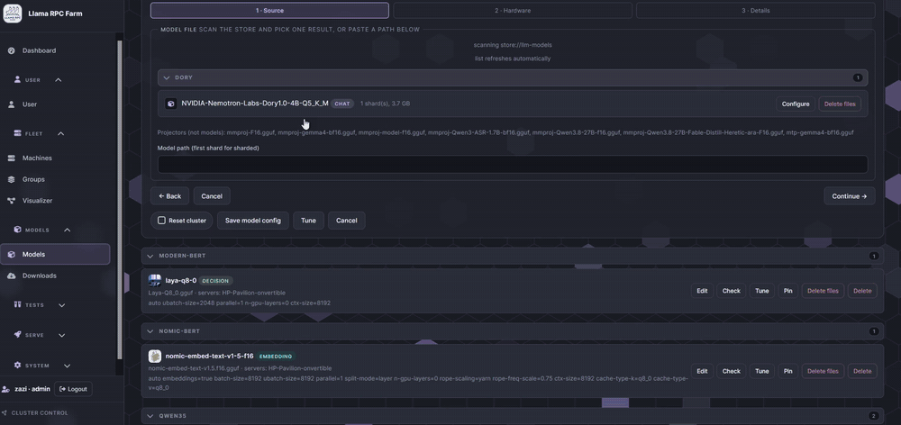
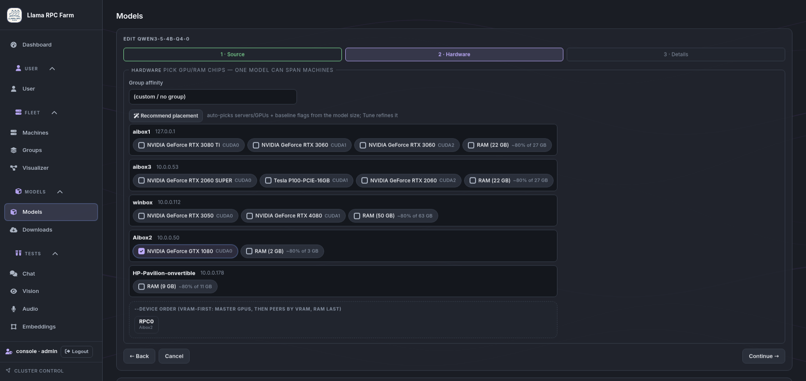
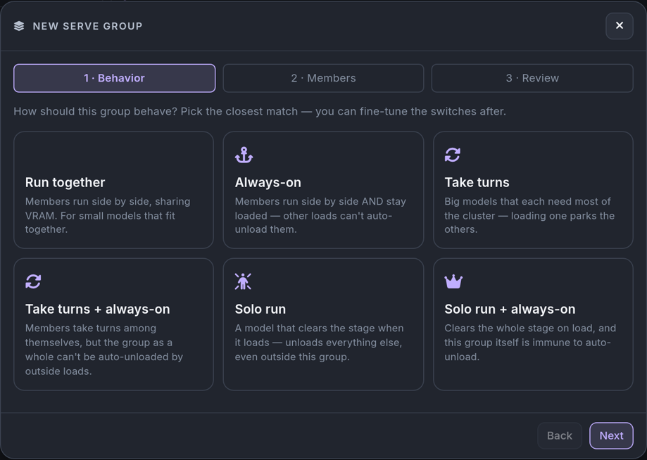
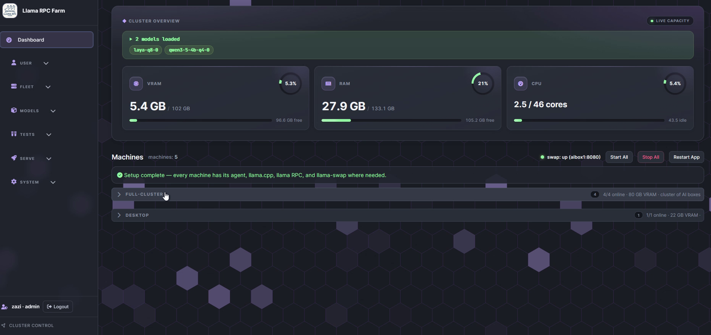
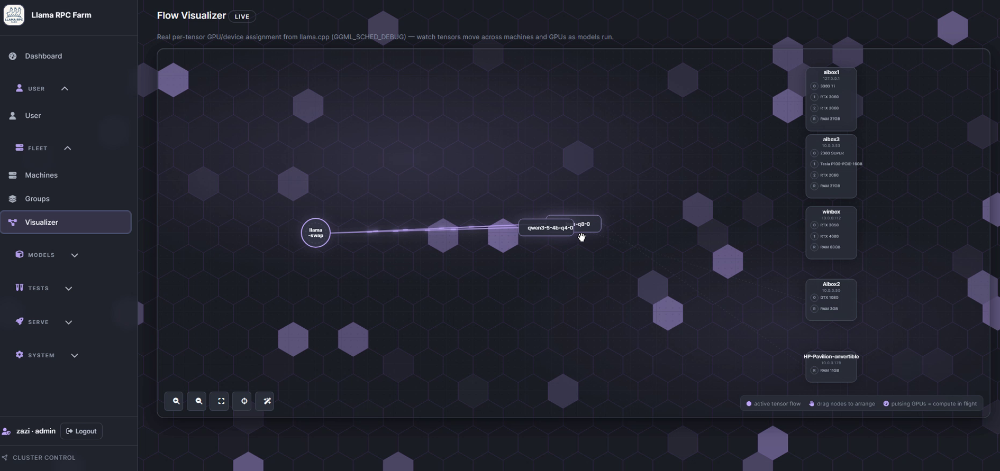
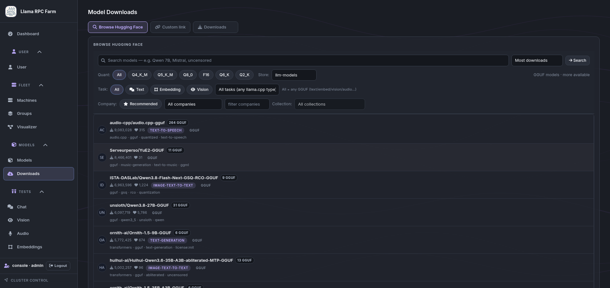

# Llama RPC Farm

[](https://github.com/dakotacookson/Llama-RPC-Farm/stargazers)
[](https://github.com/dakotacookson/Llama-RPC-Farm/releases)
[](https://github.com/dakotacookson/Llama-RPC-Farm/actions/workflows/ci.yml)
[](LICENSE)

**True llama.cpp, from one box to your whole house.** One dashboard for
real llama.cpp serving: run a model on a single machine, pool GPUs and RAM
across machines over RPC, or serve many models on demand through
llama-swap — any mix of Linux, Windows, and macOS machines. Any client
that speaks OpenAI.

It started with the GPUs already in the house: a few machines, different
cards, and no clean way to make them one usable endpoint. Hand-rolled
`llama-server --rpc` scripts worked until a second model, a Windows box, or
a family member needed access. Llama RPC Farm is the dashboard that grew
out of that: stock llama.cpp underneath, one place to arrange machines and
models, and one OpenAI-compatible endpoint on top.



- **Good fit:** spare GPUs across a few boxes, mixed OSes, one endpoint,
  stock llama.cpp flags, per-user model access.
- **Not the goal:** public multi-tenant serving, a new inference runtime,
  or automatic device discovery with its own scheduler. The farm drives
  stock llama.cpp builds; placement stays explicit and visible.

**[Download installers](https://github.com/dakotacookson/Llama-RPC-Farm/releases/latest)**
· [Quick start](#quick-start) · [Documentation](#documentation) ·
[Discussions](https://github.com/dakotacookson/Llama-RPC-Farm/discussions)

## What it does

- **Pool machines into one cluster** — pick which GPUs (and RAM) each box
  shares; peers run RPC servers started through the peer agent.

  

- **Serve many models on demand** — llama-swap starts and stops each model's
  llama-server the moment a client asks, and frees the GPUs when it's done.
  Group models to run together, stay always-on, take turns, or run solo.

  

- **Keep it simple day to day** — live dashboard (VRAM, temp, RPC state),
  per-model flag editor, one-click generated launch scripts, auto-tuner.

  

- **Watch the cluster think** — the Flow Visualizer shows real per-tensor
  device assignment straight from llama.cpp's scheduler: which GPU on
  which machine is handling what, live, as models run. Pulsing GPUs are
  compute in flight.

  

- **Find and fetch models without leaving the farm** — the built-in
  Hugging Face browser searches the Hub with GGUF-aware filters (quant,
  task, company, collection), shows sharded variants as one model, and
  downloads straight into your shared `store://` path so every machine
  sees it immediately.

  

## Deployment topologies

Each model picks the topology that suits its hardware — automatically
(`launch_mode: auto`) or explicitly. All of them sit behind the same
llama-swap endpoint.

| Topology | Where inference runs | Use it when |
|---|---|---|
| **Single box** | one machine, no RPC | the model fits on one box. CUDA, ROCm, Vulkan, Metal and CPU-only are all first-class |
| **Multi-box RPC cluster** | host machine, with `--rpc` to peers | the model is too big for one box; pool GPUs and host RAM across machines |
| **Peer-local** | a peer, started through its agent | compute belongs on another box, but clients still use one farm endpoint |
| **Custom runtime** | an external OpenAI-compatible server the agent starts/stops | you already have a non-llama.cpp stack |
| **MLX** | Apple Silicon via `mlx_lm.server` | Mac-native serving without RPC or device flags |

MLX and custom runtimes are **separate runtimes, not llama.cpp RPC
peers** — one model is either MLX (one Mac), custom (one external server),
or llama.cpp (which may span boxes). Recipes, topology details, and
combinations to avoid: **[docs/topologies.md](docs/topologies.md)**.

## Quick start

### Install a release (recommended)

Grab the newest
[release](https://github.com/dakotacookson/Llama-RPC-Farm/releases/latest):
Linux `.deb`, macOS `.pkg`, Windows `setup.exe` for the app, plus matching
peer-agent packages and a universal agent wheel. Packaged builds start at
login and include the embedded gateway.

### From source

```bash
./install.sh    # Linux/macOS     (Windows: install.bat)
./run.sh        # then open http://localhost:8199

./farmctl status                       # headless CLI over the same API
./farmctl start                       # start llama-swap (loads on demand)
./farmctl launch --model my-model     # warm ONE model
./farmctl doctor                      # readiness checklist
```

The install script sets up the app and Python environment only. On first
launch, the dashboard's **Setup needed** panel installs llama.cpp + RPC on
peers and llama-swap on the swap host. Full walkthrough:
**[docs/setup.md](docs/setup.md)**.

> **LAN/VPN only.** llama.cpp's RPC server is unauthenticated by design.
> Keep RPC ports, the UI, and the gateway on a trusted network or VPN — do
> not port-forward them to the internet. Details: **[SECURITY.md](SECURITY.md)**.

**No cluster yet?** Run it solo on one machine first — one GPU, several
GPUs, or CPU/RAM only. The same UI, model configs, and endpoint work when
you add peers later; nothing needs to be rebuilt. A two-machine test path
is in **[docs/examples.md](docs/examples.md)**.

### Let your AI agent do it

This repo ships an agent playbook (`AGENTS.md`). Tell your coding agent:

> Clone https://github.com/dakotacookson/Llama-RPC-Farm, open the folder,
> and follow the "AI agent quick playbook" in AGENTS.md to install and
> start the app. Then walk me through adding my machines and models per
> docs/setup.md.

## Connect a client

Point any OpenAI-compatible client at the gateway (`:8090`) or llama-swap
directly (`:8080`). Keys, per-user model grants, and client configs:
**[docs/access.md](docs/access.md)**.

```bash
curl http://<master-ip>:8090/v1/chat/completions \
  -H "Authorization: Bearer sk-farm-XXXX" \
  -H "Content-Type: application/json" \
  -d '{"model":"my-model-128k",
       "messages":[{"role":"user","content":"hi"}],
       "stream":true}'
```

## Supported hardware

Master and peers can be any mix; llama.cpp decides the backends. This code
supports a wide matrix, but only a slice of it is battle-tested so far —
**everything untested below works exactly as the tested paths do (same
scripts, same probe, same dashboard), it just needs real-world users**:

| Setup | Status |
|---|---|
| x86_64 Linux (master & peers) | ✅ Tested — daily-driver config |
| NVIDIA GPUs, Linux (CUDA) | ✅ Tested by @dakotacookson — multi-GPU tensor-split, RPC + local GPU mix |
| NVIDIA GPUs, Windows peers | ✅ Tested by @dakotacookson — RPC over the peer agent |
| CPU + RAM sharing over RPC | ✅ Tested by @dakotacookson |
| Raspberry Pi 4/5, 64-bit (Trixie / Ubuntu 24.04) | ✅ arm64 prebuilt — CPU-only RPC peer or single-box (glibc ≥ 2.38) |
| Raspberry Pi 4/5, 64-bit (Bookworm) | ✅ source build — Bookworm's glibc 2.36 cannot load the arm64 prebuilt |
| AMD GPUs (ROCm/HIP, `rocm-smi` stats) | 🧪 Code paths complete, needs contributors to test |
| Apple Silicon (Metal backend) | ✅ Tested by @joshuamsalazar — Metal backend |
| Intel XPU (SYCL) | 🧪 Vendor supported in detection/scripts, untested |

Raspberry Pis are CPU-only over llama.cpp RPC (no VideoCore backend): use
one as a small single-box endpoint or as an extra RAM/CPU peer. Setup and
the Bookworm-vs-Trixie matrix: [docs/raspberry-pi.md](docs/raspberry-pi.md).

Each backend speaks the same tokens (`CUDA0/1..`, `ROCm0/1..`, `Metal`,
`CPU`) and flows through identical launch scripts — see
[docs/rpc-model.md](docs/rpc-model.md) for internals. If your setup is in
the 🧪 rows and it works (or breaks), that's a valuable bug report /
contribution — [open an issue](https://github.com/dakotacookson/Llama-RPC-Farm/issues)
with your hardware, logs, and what you tried, or start a thread in
[Discussions](https://github.com/dakotacookson/Llama-RPC-Farm/discussions).
"Works on my box" reports are exactly what turns a 🧪 row into ✅.

## Performance

Pooling over RPC trades tokens/sec for reach. A split model across
machines will be slower per-token than the same model on one box — that's
physics, and it's the price of using GPUs that would otherwise sit idle.
If a model fits on one machine, keep it there.

Real auto-tune runs from the maintainer's fleet (server-reported llama.cpp
timings, decode tok/s, 64 generated tokens — not a controlled benchmark):

| Scenario | Model | Placement | Context | Decode |
|---|---|---|---|---|
| 4B Q4_K over RPC | 4B-class Q4_K | 3 Linux boxes, 6 GPUs, split `8,3,3,2,1,1` | 16k | ~130 tok/s |
| 27B Q8_0 over RPC + MTP | Qwen3.8-27B-Uncensored Q8_0 | 3 Linux boxes, 6 GPUs | 180k | ~24.6 tok/s |

The tuner writes every trial to `generated/tune-history.csv`. Methodology
and a report template: **[docs/benchmarks.md](docs/benchmarks.md)**.

## How is this different?

| | Llama RPC Farm | Hand-rolled llama.cpp RPC | exo |
|---|---|---|---|
| **Inference engine** | Stock llama.cpp builds | Stock llama.cpp | Its own runtime/device mesh |
| **Cluster setup** | UI: pick machines + GPU/RAM chips | You write the `--rpc` scripts | Automatic peer discovery |
| **Many models, one endpoint** | llama-swap on demand + serve groups | You wire it yourself | Different model/runtime model |
| **Lifecycle** | Start/stop/status per model and per machine | Shell scripts + manual cleanup | Managed by exo |
| **Mixed OS fleet** | Linux, Windows, macOS peers via typed agent | Per-OS scripts and quoting | Varies by support |
| **Client access** | Per-key model allowlists + `:8090` gateway | Not included | Not the focus |
| **Placement visibility** | Live per-tensor Flow Visualizer from llama.cpp sched logs | Logs only | Not llama.cpp sched |

The trade-off is deliberate: the farm does **not** invent a new inference
runtime. It drives the same llama.cpp binaries you would use by hand, so
every upstream flag and backend upgrade works as-is. If you already have a
working hand-rolled script, the farm removes the per-model/per-machine
script sprawl and adds llama-swap's on-demand start/stop, the dashboard,
and per-user keys. It is not a replacement for LocalAI/vLLM model zoos or
serving stacks — it is for people who want **stock llama.cpp** and explicit
control over where every layer runs. More:
**[docs/faq.md](docs/faq.md)**.

## Documentation

| Doc | What it covers |
|-----|----------------|
| [docs/setup.md](docs/setup.md) | Step-by-step install, machines, stores, engines, clients |
| [docs/topologies.md](docs/topologies.md) | Single-box, RPC, peer-local, custom, MLX; recipes and anti-patterns |
| [docs/access.md](docs/access.md) | Users, API keys, per-key model grants, gateway, client config |
| [docs/benchmarks.md](docs/benchmarks.md) | Real measured runs, reproduction, submit your numbers |
| [docs/testing.md](docs/testing.md) | Test bench (chat/vision/audio/embeddings/decision) and test suite |
| [docs/faq.md](docs/faq.md) | RPC speed, matching GPUs, Windows, security, and common questions |
| [docs/architecture.md](docs/architecture.md) | Module map, request/data flow |
| [docs/rpc-model.md](docs/rpc-model.md) | RPC numbering, device tokens, ports, generated scripts |
| [docs/configuration.md](docs/configuration.md) | Every config file, what owns it |
| [docs/api.md](docs/api.md) | Full HTTP/WebSocket endpoint reference |
| [docs/README.md](docs/README.md) | Full documentation index |

Security: **[SECURITY.md](SECURITY.md)**. Contributing:
**[CONTRIBUTING.md](CONTRIBUTING.md)**. Wrapped-engine licenses:
**[THIRD-PARTY-LICENSES.md](THIRD-PARTY-LICENSES.md)**.

## Community

- [Discussions](https://github.com/dakotacookson/Llama-RPC-Farm/discussions) — questions, setups, show and tell
- [Issues](https://github.com/dakotacookson/Llama-RPC-Farm/issues) — bugs and hardware reports
- [Roadmap](https://github.com/dakotacookson/Llama-RPC-Farm/issues/108) — what would make the farm more useful to you
- Hardware reports wanted: [AMD ROCm #105](https://github.com/dakotacookson/Llama-RPC-Farm/issues/105), [Intel SYCL #107](https://github.com/dakotacookson/Llama-RPC-Farm/issues/107)
- Benchmarks wanted: [1 vs 2 vs 3 boxes #106](https://github.com/dakotacookson/Llama-RPC-Farm/issues/106)

## Standing on giants

This project is an orchestration layer only — the engines are the real
work of two projects we build on and depend on, installed as required
downloads (both MIT-licensed):

- **[llama.cpp](https://github.com/ggml-org/llama.cpp)** — `llama-server`,
  `ggml-rpc-server`, tensor splitting, Metal/CUDA/ROCm/SYCL backends.
- **[llama-swap](https://github.com/mostlygeek/llama-swap)** — the
  on-demand model start/stop proxy behind the one endpoint.

We do not copy or modify their code — the farm talks to them by
downloading official builds and over HTTP. Full license details:
[THIRD-PARTY-LICENSES.md](THIRD-PARTY-LICENSES.md).

## Status

Current release line: **2.0.x** — see
[GitHub Releases](https://github.com/dakotacookson/Llama-RPC-Farm/releases)
for the newest build and installers. llama.cpp RPC + llama-swap is the
supported engine. The rolling build publishes Linux `.deb`, macOS `.pkg`,
and Windows `setup.exe` artifacts, plus the peer-agent packages, on every
`main` build.

Licensed under **Apache-2.0** (this project's own code; download engines
llama.cpp and llama-swap remain MIT under their own terms) — free for
personal and commercial use. If it saves you a GPU headache, the GitHub
**Sponsors** button is right up there. Contributions welcome — see
[CONTRIBUTING.md](CONTRIBUTING.md); every PR is review-approved by the
maintainer.
