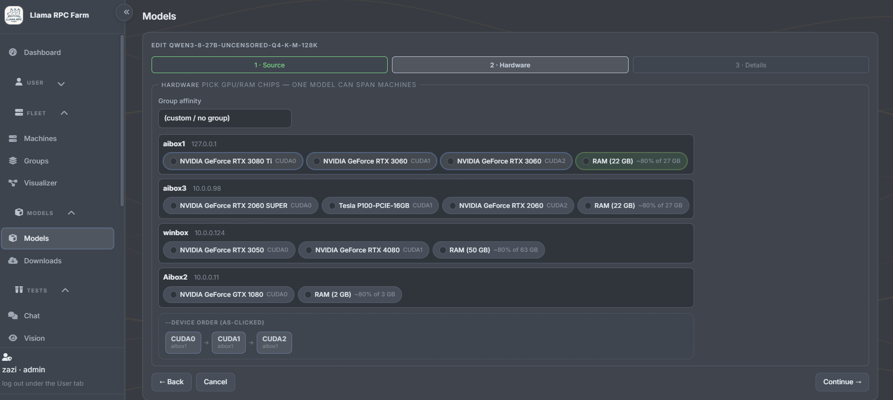
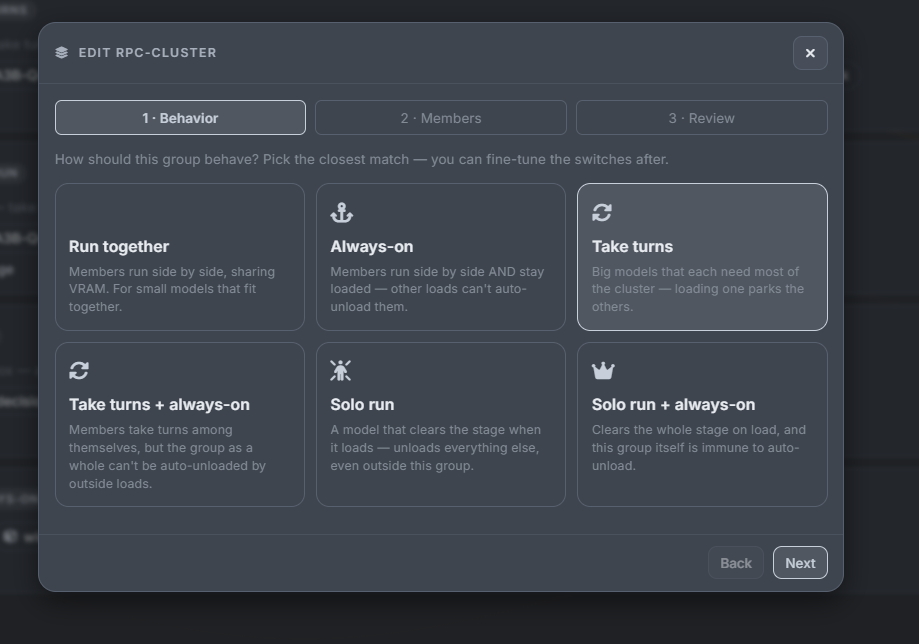
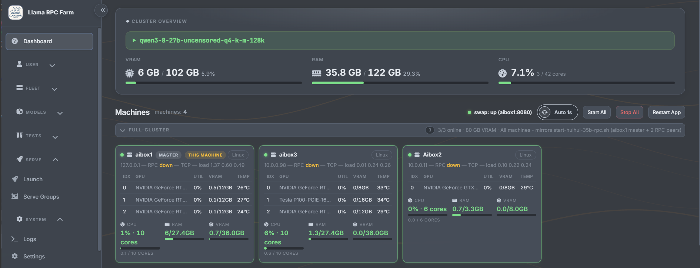
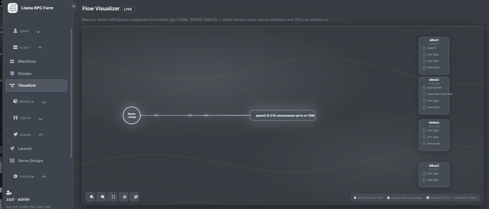
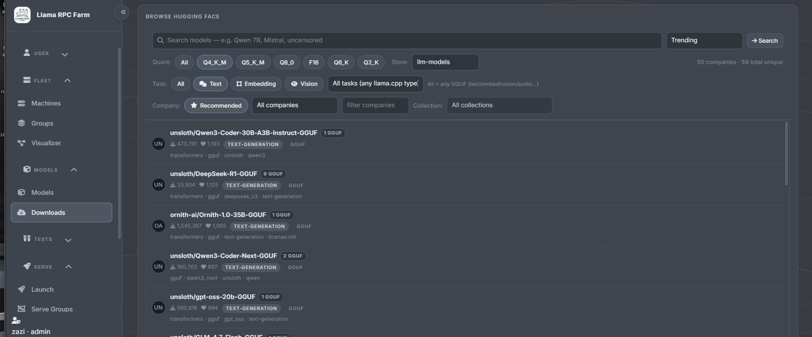
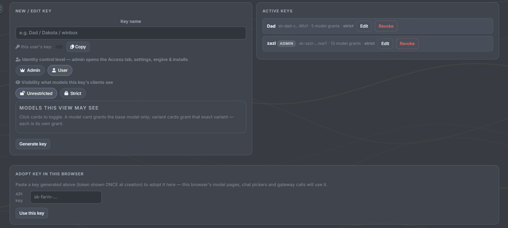
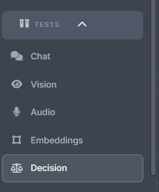

# Llama RPC Farm

[](https://github.com/dakotacookson/Llama-RPC-Farm/stargazers)
[](https://github.com/dakotacookson/Llama-RPC-Farm/releases)
[](https://github.com/dakotacookson/Llama-RPC-Farm/actions/workflows/ci.yml)
[](LICENSE)

**True llama.cpp, from one box to your whole house.** One dashboard for
real llama.cpp serving: run a model on a single machine, pool GPUs and RAM
across machines over RPC, or serve many models on demand through
llama-swap — any mix of Linux, Windows, and macOS machines. Any client
that speaks OpenAI.

It started with the GPUs already in the house: a few machines, different
cards, and no clean way to make them one usable endpoint. Hand-rolled
`llama-server --rpc` scripts worked until a second model, a Windows box, or
a family member needed access. Llama RPC Farm is the dashboard that grew
out of that: stock llama.cpp underneath, one place to arrange machines and
models, and one OpenAI-compatible endpoint on top.

Real llama.cpp means real features: full CUDA, tensor-split across GPUs,
spec decoding, KV-cache options, 128k+ contexts — the raw llama-server
features, wired together across machines for you, instead of hand-rolled
startup scripts.

**Your existing configs and scripts stay untouched.** The farm keeps its own
state under this folder (or the platform data dir for packaged builds);
engine/agent installs go to standard user locations such as
`~/.local/bin`, systemd user units, and the swap host's
`~/.config/llama-swap/`.

## What it does

- **Pool machines into one cluster** — pick which GPUs (and RAM) each box
  shares; peers run RPC servers started through the peer agent.

  

- **Serve many models on demand** — llama-swap starts and stops each model's
  llama-server the moment a client asks, and frees the GPUs when it's done.
  Group models with the loading behavior that fits: run together, always-on,
  take turns, or solo.

  

- **Keep it simple day to day** — live dashboard (VRAM, temp, RPC state),
  per-model flag editor, one-click generated launch scripts, auto-tuner.

  

- **Watch the cluster think** — the Flow Visualizer shows real per-tensor
  device assignment straight from llama.cpp's scheduler: which GPU on
  which machine is handling what, live, as models run. Pulsing GPUs are
  compute in flight.

  

- **Find and fetch models without leaving the farm** — the built-in
  Hugging Face browser searches the Hub with GGUF-aware filters (quant,
  task, company, collection), shows you sharded variants as one model,
  and downloads straight into your shared `store://` path so every
  machine sees it immediately.

  

## Serve it the way it fits

This is not an RPC-only tool. Each model deployment picks the topology that
actually suits the hardware — automatically (`launch_mode: auto`) or
explicitly — and every one of them sits behind the same llama-swap endpoint.

| Topology | Where inference runs | Use it when |
|---|---|---|
| **Single box** | one machine, no RPC | the model fits on one box. CUDA, ROCm, Vulkan, Metal and CPU-only are all first-class |
| **Multi-box RPC cluster** | host machine, with `--rpc` to peers | the model is too big for one box; pool GPUs and host RAM across machines |
| **Peer-local (remote-local)** | a peer, started through its agent | compute belongs on another box, but clients still use one farm endpoint (llama-swap proxies to it) |
| **Custom runtime** | an external OpenAI-compatible server the agent starts/stops | you already have a non-llama.cpp stack (for example a Windows `.bat` runtime) |
| **MLX** | Apple Silicon via `mlx_lm.server` | Mac-native serving without RPC or device flags |

MLX is a **separate runtime, not a llama.cpp backend**: it cannot join a
model's `--rpc` device graph or take part in tensor splitting. It can sit
alongside llama.cpp/RPC models behind llama-swap as its own model entry, but
a single model is either MLX (one Mac) or llama.cpp (which may span boxes).
The same applies to **custom runtimes**: they are proxied standalone OpenAI
servers, not RPC peers. To put an Apple Silicon GPU into a llama.cpp cluster,
use the **Metal** backend (`Metal` device token) — that is llama.cpp's own
Apple GPU backend, still llama.cpp — not MLX. MLX and llama.cpp/Metal are two
different ways to serve on a Mac; only the latter can join the RPC graph.

And one endpoint can front **many** models at once:

- **On-demand loading** — llama-swap starts a model when a request arrives
  and unloads it after its TTL; pinned/always-on models stay warm.
- **Serve groups** — make models take turns (`swap`), evict everything else
  when one loads (`exclusive`), or keep a set loaded together (`persistent`).
- **Variants** — the same weights with different context sizes, hardware,
  flags or split layouts, published as separate model ids.
- **Per-key views** — each access key sees only the models it is granted,
  through the embedded `:8090` gateway.

So the same install can be a single-GPU dev box, a multi-machine GPU pool for
one giant model, a multi-model household server, or a mix of all three — with
the same model configs, dashboard, gateway and client API.

### Heterogeneous multi-node, done properly

Master and peers can be any mix of Linux, Windows and macOS. The master
orchestrates; each peer runs its native `ggml-rpc-server` (or `llama-server`
for peer-local deployments) through the peer agent. There is no SSH and no
shared shell — every peer operation is a typed agent call, so Windows
PowerShell, macOS process quirks and Linux all behave the same.

The tensor placement itself is llama.cpp's scheduler: it distributes model
layers/tensors across the selected devices, and the farm supplies the
`--rpc`, `--device` and `--tensor-split`/`--fit` plan it needs. The Flow
Visualizer then reads the real per-tensor GGML sched log lines and shows
which GPU on which machine is executing each tensor, live while the model
runs. One OpenAI-compatible endpoint can therefore span several boxes and
several GPUs without hiding what the scheduler is actually doing.

### Combinations that work

These are the shapes the farm is designed around, drawn from a working mixed
fleet (Linux master + Linux peers + Windows box + CPU laptop):

1. **One big model across two boxes (RPC)** — host with 3 GPUs, peer with 3
   GPUs (or 2 GPUs + shared RAM). `servers: [host, peer]`,
   `device_order` lists every selected chip, `tensor_split_mode: fit` (or
   explicit `split` weights). llama-server runs on the host, peers run
   `ggml-rpc-server`, clients see one model.
2. **Same weights, two placements (base + variant)** — base on the host
   (`servers: [aibox1]`) for everyday use; a variant on a peer
   (`servers: [aibox3]`, `launch_mode: local`) so llama-server runs there and
   llama-swap proxies to it. Different access keys can expose base vs
   variant to different people.
3. **Small models per box, one endpoint** — a 4B on one peer (remote-local),
   ASR + embeddings on a CPU/RAM box, and an external native server on
   Windows, all listed by the same llama-swap instance.
4. **Take-turns group on one box** — several 27–35B models that do not fit
   together; `swap: true` so loading one evicts the group's others.
5. **Exclusive "clear the stage" group** — a model that needs all of a
   box's VRAM; `swap: true, exclusive: true` so loading it evicts everything.
6. **Always-on co-serving group** — ASR + embeddings + a small decision model
   on a dedicated box; `persistent: true` keeps them all loaded.
7. **CPU/RAM-only node** — a laptop with no usable GPU: `device_order:
   box-RAM`, `n-gpu-layers: 0`. Good for embeddings, ASR and small decision
   models.
8. **Windows peer** — for big models, use it as an **RPC peer** (Windows only
   runs `ggml-rpc-server`; the host reads the GGUF). For an existing native
   server, use `runtime: custom` with an agent-managed `.bat`. Avoid
   remote-local `llama-server` on Windows for SMB model paths.

### Combinations to avoid

- **MLX + RPC peers in one model** — MLX is single-Mac; peers are ignored.
- **A persistent group whose members do not all fit in VRAM together** —
  every member stays loaded; the last one will fail.
- **The same model in two `swap: true` groups** — only the first group wins.
- **`tensor_split_mode: split` with a weight count that differs from
  `--device`** — layers get mis-assigned.
- **`fit` + a RAM device when you expect pure fit** — the farm downgrades to
  a computed split (llama.cpp's RAM-last fitter bug).
- **Custom runtime with more than one server** — it manages exactly one
  external OpenAI server.

The app now shows these as non-blocking warnings when you save a model,
machine group, or serve group, so you see the problem at configuration time
instead of at first load.

## Quick start

```bash
./install.sh    # Linux/macOS     (Windows: install.bat)
./run.sh        # then open http://localhost:8199
```

> **LAN/VPN only.** llama.cpp's RPC server is unauthenticated by design.
> Keep RPC ports, the UI, and the gateway on a trusted network or VPN — do
> not port-forward them to the internet. Details: [Security model](#security-model).

**No cluster yet?** Run it solo on one machine first — one GPU, several
GPUs, or CPU/RAM only. The same UI, model configs, and endpoint work when
you add peers later; nothing needs to be rebuilt. A two-machine test path
is in [docs/examples.md](docs/examples.md).

The install script sets up the app and Python environment only. On first
launch, the dashboard's **Setup needed** panel installs llama.cpp + RPC on
peers and llama-swap on the swap host. The full walkthrough (vault,
machines, stores, engines, gateway, client config) is in
**[docs/setup.md](docs/setup.md)**.

Windows SmartScreen warning on the unsigned installer? See
**[docs/windows-signing.md](docs/windows-signing.md)** for the safe
"More info → Run anyway" steps and how to sign future builds.

### Try it with your AI agent in one prompt

This repo ships an agent playbook (`AGENTS.md`), so any coding agent that
reads AGENTS.md can install and manage the farm for you. Tell your agent:

> Clone https://github.com/dakotacookson/Llama-RPC-Farm, open the folder,
> and follow the "AI agent quick playbook" in AGENTS.md to install and
> start the app. Then walk me through adding my machines and models per
> docs/setup.md.

That's it — the agent handles install, startup, and configuration while
you supervise.

## Users & API keys

Every client identifies with a farm API key — there's nothing else to set
up. In the UI (settings/access keys), create one key per person or
device; each key gets a **model allowlist**, so your kid's PC shows only
the fast 4B, your coding box shows the coder models, and an admin key
sees everything. Keys are also how usage is attributed per user in the
dashboard.



Clients send the key as a normal auth header — same style as OpenAI:

```bash
curl http://<master-ip>:8090/v1/chat/completions \
  -H "Authorization: Bearer sk-farm-XXXX" \
  -H "Content-Type: application/json" \
  -d '{
    "model": "my-model-128k",
    "messages": [{"role": "user", "content": "hi"}],
    "stream": true
  }'
```

`X-Api-Key: sk-...` works identically; `Authorization: Bearer` is just
what every OpenAI-compatible tool already sends, so most of the time you
only ever paste the key once. The master (or any trusted IP) can skip the
key entirely. List what a key can see:

```bash
curl http://<master-ip>:8090/v1/models -H "Authorization: Bearer sk-farm-XXXX"
```

Admins manage it all from the UI — create/revoke keys, edit who sees
what, and watch per-key usage. Access keys live in the per-install,
git-ignored `config/settings.yaml` (never in git); agent tokens and the
HF token live only in the encrypted vault (details in
[docs/secrets.md](docs/secrets.md)).

## Test every model type before it matters

The built-in test bench (Tests tab) covers every llama.cpp capability,
right where the models live — so you verify a model actually works
through your real cluster before a client ever sees it: **Chat**
(streaming conversations against llama-swap, any text model), **Vision**
(multimodal), **Audio**, **Embeddings**, and **Decision** (structured
choice testing). Each type routes through the same views/keys/gateway as
production traffic, so the test is the whole chain, not just the model.



## Supported hardware

Master and peers can be any mix; llama.cpp decides the backends. This code
supports a wide matrix, but only a slice of it is battle-tested so far —
**everything untested below works exactly as the tested paths do (same
scripts, same probe, same dashboard), it just needs real-world users**:

| Setup | Status |
|---|---|
| x86_64 Linux (master & peers) | ✅ Tested — this is the daily-driver config |
| NVIDIA GPUs, Linux (CUDA) | ✅ Tested by @dakotacookson — multi-GPU tensor-split, RPC + local GPU mix |
| NVIDIA GPUs, Windows peers | ✅ Tested by @dakotacookson — RPC over the peer agent |
| CPU + RAM sharing over RPC | ✅ Tested by @dakotacookson |
| AMD GPUs (ROCm/HIP, `rocm-smi` stats) | 🧪 Code paths complete, needs contributors to test |
| Apple Silicon (Metal backend) | ✅ Tested by @joshuamsalazar — Metal backend |
| Intel XPU (SYCL) | 🧪 Vendor supported in detection/scripts, untested |

Each backend speaks the same tokens (`CUDA0/1..`, `ROCm0/1..`, `Metal`,
`CPU`) and flows through identical launch scripts — see
[docs/rpc-model.md](docs/rpc-model.md) for internals. If your setup is in
the 🧪 rows and it works (or breaks), that's a valuable bug report /
contribution — [open an issue](https://github.com/dakotacookson/Llama-RPC-Farm/issues)
with your hardware, logs, and what you tried, or start a thread in
[Discussions](https://github.com/dakotacookson/Llama-RPC-Farm/discussions).
"Works on my box" reports are exactly what turns a 🧪 row into ✅.

## How it works, in one breath

The machine you run the UI on is the master; everything you add is a peer.
Model configs live as YAML, and each deployment chooses its topology:
single-box local, multi-box RPC, peer-local, custom runtime or MLX. The app
generates the exact launch plan/scripts (RPC peers first, llama-server last,
or the peer agent start for local deployments), and llama-swap fronts it all
so clients always hit one endpoint. The app also runs the `:8090` view/access
gateway in-process — no separate service to install. Secrets (agent tokens, HF token) live in an encrypted vault on your box, never in
configs, never in scripts.

### Expectations: speed

Pooling over RPC trades tokens/sec for reach. A split model across
machines will be slower per-token than the same model on one box — that's
physics, and it's the price of using GPUs that would otherwise sit idle.
The farm never pretends otherwise; if a model fits on one machine, keep
it there, and use the cluster for the ones that don't.

#### Measured on a real farm

From the maintainer's auto-tune history — server-reported llama.cpp
timings, decode tok/s (prefill excluded), 64 generated tokens. These are
real runs, not a controlled benchmark:

| Scenario | Model | Placement | Context | Decode |
|---|---|---|---|---|
| 4B Q4_K over RPC | 4B-class Q4_K | 3 Linux boxes, 6 GPUs, split `8,3,3,2,1,1` | 16k | ~130 tok/s |
| 27B Q8_0 over RPC + MTP | Qwen3.8-27B-Uncensored Q8_0 | 3 Linux boxes, 6 GPUs | 180k | ~24.6 tok/s |

Both are real RPC runs from the maintainer's fleet; a single-box run of the
same weights is faster (that is the trade-off above). The tuner writes
every trial to `generated/tune-history.csv`, so you can reproduce or
replace these with your own numbers. Methodology and a contribution
template: [docs/benchmarks.md](docs/benchmarks.md).

### How is this different?

| | Llama RPC Farm | Hand-rolled llama.cpp RPC | exo |
|---|---|---|---|
| **Inference engine** | Stock llama.cpp builds | Stock llama.cpp | Its own runtime/device mesh |
| **Cluster setup** | UI: pick machines + GPU/RAM chips | You write the `--rpc` scripts | Automatic peer discovery |
| **Many models, one endpoint** | llama-swap on demand + serve groups | You wire it yourself | Different model/runtime model |
| **Lifecycle** | Start/stop/status per model and per machine | Shell scripts + manual cleanup | Managed by exo |
| **Mixed OS fleet** | Linux, Windows, macOS peers via typed agent | Per-OS scripts and quoting | Varies by support |
| **Client access** | Per-key model allowlists + `:8090` gateway | Not included | Not the focus |
| **Tensor placement visibility** | Live per-tensor Flow Visualizer from llama.cpp sched logs | Logs only | Not llama.cpp sched |

The trade-off is deliberate: the farm does **not** invent a new inference
runtime. It drives the same llama.cpp binaries you would use by hand, so
every upstream flag and backend upgrade works as-is. If you already have a
working hand-rolled script, the farm removes the per-model/per-machine
script sprawl and adds llama-swap's on-demand start/stop, the dashboard,
and per-user keys. If you want a fully automatic device mesh with its own
runtime, exo is a different (and better-fit) tool.

Likewise, it is not a replacement for LocalAI/vLLM model zoos or serving
stacks — it is for people who want **stock llama.cpp** and explicit control
over where every layer runs.

## Security model

**This is a homelab tool for trusted networks.** llama.cpp's RPC server
is unauthenticated by design; the farm assumes your LAN or a VPN
(Tailscale-style) is the boundary. Don't port-forward the RPC ports or
the UI to the public internet. What the app does touch: HTTP to peer agents on machines you add, and
downloads from official GitHub releases for llama.cpp, llama-swap, and the
peer agent (agent tokens live in the encrypted `.env` vault, never in
configs or scripts). Everything else stays inside the project folder.

## Documentation

| Doc | What it covers |
|-----|----------------|
| [docs/setup.md](docs/setup.md) | Step-by-step install & setup guide |
| [docs/architecture.md](docs/architecture.md) | Module map, request/data flow |
| [docs/rpc-model.md](docs/rpc-model.md) | How RPC clustering & numbering works |
| [docs/secrets.md](docs/secrets.md) | The encrypted vault, how passwords flow |
| [docs/configuration.md](docs/configuration.md) | Every config file, what owns it |
| [docs/api.md](docs/api.md) | Full HTTP/WebSocket endpoint reference |
| [docs/benchmarks.md](docs/benchmarks.md) | What was measured, how to reproduce it, and how to submit your numbers |
| [docs/README.md](docs/README.md) | Full documentation index |

## Standing on giants

This project is an orchestration layer only — the engines are the real
work of two projects we build on and depend on, installed as required
downloads (both MIT-licensed):

- **[llama.cpp](https://github.com/ggml-org/llama.cpp)** (ggml-org) — the
  inference engine itself: `llama-server`, `ggml-rpc-server`, tensor
  splitting, Metal/CUDA/ROCm/SYCL backends. Nothing here would exist
  without it.
- **[llama-swap](https://github.com/mostlygeek/llama-swap)** (mostlygeek)
  — the on-demand model start/stop proxy that makes multi-model serving
  from one endpoint possible.

We do not copy or modify their code — the farm talks to them by
downloading official builds and over HTTP. Full license details for
llama.cpp, llama-swap, and every other wrapped tool:
[THIRD-PARTY-LICENSES.md](THIRD-PARTY-LICENSES.md).

## Status

Current release line: **2.0.x** — see
[GitHub Releases](https://github.com/dakotacookson/Llama-RPC-Farm/releases)
for the newest build and installers. llama.cpp RPC + llama-swap is the
supported engine. The rolling build publishes Linux `.deb`, macOS `.pkg`,
and Windows `setup.exe` artifacts, plus the peer-agent packages, on every
`main` build.

Licensed under **Apache-2.0** (this project's own code; download engines
llama.cpp and llama-swap remain MIT under their own terms) — free for
personal and commercial use. If it saves you a GPU headache, the GitHub
**Sponsors** button is right up there. Licensing of
wrapped tools: [THIRD-PARTY-LICENSES.md](THIRD-PARTY-LICENSES.md).
Contributions welcome — see [CONTRIBUTING.md](CONTRIBUTING.md); every PR
is review-approved by the maintainer.