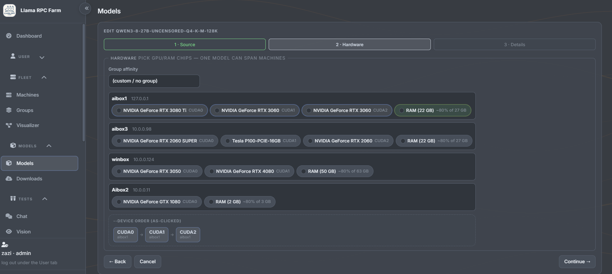
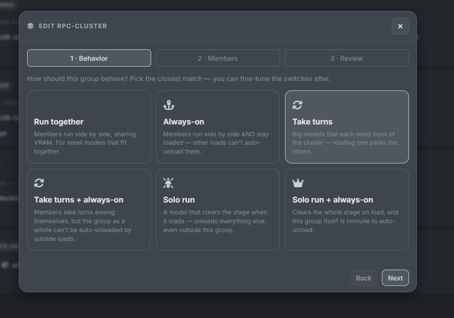
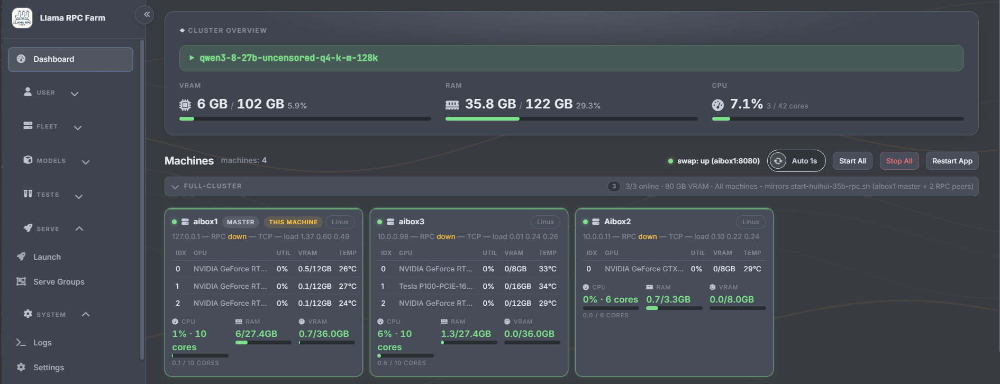
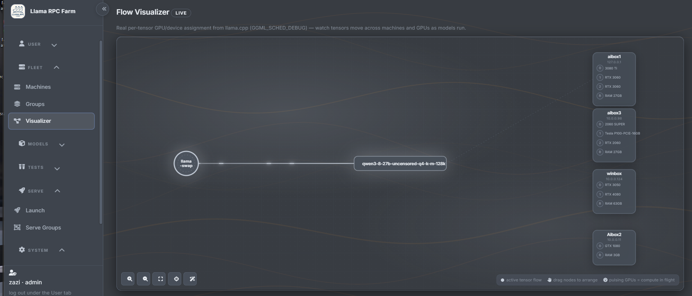
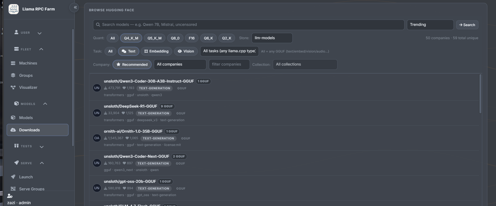
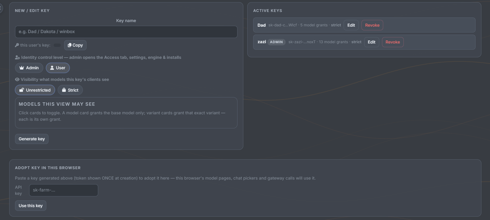

# Llama RPC Farm

**True llama.cpp, over your whole house.** One dashboard that spans real
multi-machine llama.cpp RPC clusters — your desktops' GPUs pooled across
boxes — and on-demand multi-model serving through llama-swap. Any mix of
Linux, Windows, and macOS machines. Any client that speaks OpenAI.

Real llama.cpp means real speed: full CUDA, tensor-split across GPUs, spec
decoding, KV-cache options, 128k+ contexts — the raw llama-server features,
wired together across machines for you, instead of fighting SSH and
hand-rolled startup scripts.

**Nothing outside this folder is ever modified.** Your existing
`llama.cpp/`, `llama-swap/` configs, and scripts stay untouched.

## What it does

- **Pool machines into one cluster** — pick which GPUs (and RAM) each box
  shares; peers run RPC servers started for you over SSH.

  

- **Serve many models on demand** — llama-swap starts and stops each model's
  llama-server the moment a client asks, and frees the GPUs when it's done.
  Group models with the loading behavior that fits: run together, always-on,
  take turns, or solo.

  

- **Keep it simple day to day** — live dashboard (VRAM, temp, RPC state),
  per-model flag editor, one-click generated launch scripts, auto-tuner.
  A built-in Hugging Face browser finds and downloads GGUF models straight
  into your shared store.

  

- **Watch the cluster think** — the Flow Visualizer shows real per-tensor
  device assignment straight from llama.cpp's scheduler: which GPU on
  which machine is handling what, live, as models run. Pulsing GPUs are
  compute in flight.

  

- **Find and fetch models without leaving the farm** — the built-in
  Hugging Face browser searches the Hub with GGUF-aware filters (quant,
  task, company, collection), shows you sharded variants as one model,
  and downloads straight into your shared `store://` path so every
  machine sees it immediately.

  

## Quick start

```bash
./install.sh    # Linux/macOS     (Windows: install.bat)
./run.sh        # then open http://localhost:8199
```

That's the entire setup path — the full walkthrough (vault, machines,
stores, llama.cpp build, llama-swap, gateway, client config) is in
**[docs/setup.md](docs/setup.md)**.

### Try it with your AI agent in one prompt

This repo ships an agent playbook (`AGENTS.md`), so any coding agent that
reads AGENTS.md can install and manage the farm for you. Tell your agent:

> Clone https://github.com/dakotacookson/Llama-RPC-Farm, open the folder,
> and follow the "AI agent quick playbook" in AGENTS.md to install and
> start the app. Then walk me through adding my machines and models per
> docs/setup.md.

That's it — the agent handles install, startup, and configuration while
you supervise.

## Users & API keys

Every client identifies with a farm API key — there's nothing else to set
up. In the UI (settings/access keys), create one key per person or
device; each key gets a **model allowlist**, so your kid's PC shows only
the fast 4B, your coding box shows the coder models, and an admin key
sees everything. Keys are also how usage is attributed per user in the
dashboard.



Clients send the key as a normal auth header — same style as OpenAI:

```bash
curl http://<master-ip>:8090/v1/chat/completions \
  -H "Authorization: Bearer sk-farm-XXXX" \
  -H "Content-Type: application/json" \
  -d '{
    "model": "my-model-128k",
    "messages": [{"role": "user", "content": "hi"}],
    "stream": true
  }'
```

`X-Api-Key: sk-...` works identically; `Authorization: Bearer` is just
what every OpenAI-compatible tool already sends, so most of the time you
only ever paste the key once. The master (or any trusted IP) can skip the
key entirely. List what a key can see:

```bash
curl http://<master-ip>:8090/v1/models -H "Authorization: Bearer sk-farm-XXXX"
```

Admins manage it all from the UI — create/revoke keys, edit who sees
what, and watch per-key usage. Keys are never stored in plaintext in
configs (the vault holds them; details in
[docs/secrets.md](docs/secrets.md)).

## Supported hardware

Master and peers can be any mix; llama.cpp decides the backends. This code
supports a wide matrix, but only a slice of it is battle-tested so far —
**everything untested below works exactly as the tested paths do (same
scripts, same probe, same dashboard), it just needs real-world users**:

| Setup | Status |
|---|---|
| x86_64 Linux (master & peers) | ✅ Tested — this is the daily-driver config |
| NVIDIA GPUs, Linux (CUDA) | ✅ Tested — multi-GPU tensor-split, RPC + local GPU mix |
| NVIDIA GPUs, Windows peers | ✅ Tested — RPC over OpenSSH, firewall rules auto-managed |
| CPU + RAM sharing over RPC | 🧪 Code paths complete, needs contributors to test |
| AMD GPUs (ROCm/HIP, `rocm-smi` stats) | 🧪 Code paths complete, needs contributors to test |
| Apple Silicon (Metal backend) | 🧪 Code paths complete, needs contributors to test |
| Intel XPU (SYCL) | 🧪 Vendor supported in detection/scripts, untested |

Each backend speaks the same tokens (`CUDA0/1..`, `ROCm0/1..`, `Metal`,
`CPU`) and flows through identical launch scripts — see
[docs/rpc-model.md](docs/rpc-model.md) for internals. If your setup is in
the 🧪 rows and it works (or breaks), that's a valuable bug report /
contribution — pull requests welcome.

## How it works, in one breath

The machine you run the UI on is the master; everything you add is a peer.
Model configs live as YAML, the app generates the exact launch scripts
(RPC nodes first, llama-server last), and llama-swap fronts it all so
clients always hit one endpoint. Secrets (SSH passwords, HF token) live in
an encrypted vault on your box, never in configs, never in scripts.

## Documentation

| Doc | What it covers |
|-----|----------------|
| [docs/setup.md](docs/setup.md) | Step-by-step install & setup guide |
| [docs/architecture.md](docs/architecture.md) | Module map, request/data flow |
| [docs/rpc-model.md](docs/rpc-model.md) | How RPC clustering & numbering works |
| [docs/secrets.md](docs/secrets.md) | The encrypted vault, how passwords flow |
| [docs/configuration.md](docs/configuration.md) | Every config file, what owns it |
| [docs/api.md](docs/api.md) | Full HTTP/WebSocket endpoint reference |
| [docs/README.md](docs/README.md) | Full documentation index |

## Standing on giants

This project is an orchestration layer only — the engines are the real
work of two projects we build on and depend on, installed as required
downloads (both MIT-licensed, so a wrapper like this is legitimate):

- **[llama.cpp](https://github.com/ggml-org/llama.cpp)** (ggml-org) — the
  inference engine itself: `llama-server`, `ggml-rpc-server`, tensor
  splitting, Metal/CUDA/ROCm/SYCL backends. Nothing here would exist
  without it.
- **[llama-swap](https://github.com/mostlygeek/llama-swap)** (mostlygeek)
  — the on-demand model start/stop proxy that makes multi-model serving
  from one endpoint possible.

We do not copy or modify their code — the farm talks to them by
downloading official builds and over HTTP. Full license details for
llama.cpp, llama-swap, and every other wrapped tool:
[THIRD-PARTY-LICENSES.md](THIRD-PARTY-LICENSES.md).

## Status

v0.01. llama.cpp RPC + llama-swap is the supported engine; an experimental
vLLM mode exists behind `engine: vllm` (see
[docs/](docs/README.md) if you're curious — not a supported feature).

Licensed under **Apache-2.0** (this project's own code; download engines
llama.cpp and llama-swap remain MIT under their own terms) — free for
personal and commercial use, and free forever. If it saves you a GPU
 headache, the GitHub **Sponsors** button is right up there. Licensing of
wrapped tools: [THIRD-PARTY-LICENSES.md](THIRD-PARTY-LICENSES.md).
Contributions welcome — see [CONTRIBUTING.md](CONTRIBUTING.md); every PR
is review-approved by the maintainer.