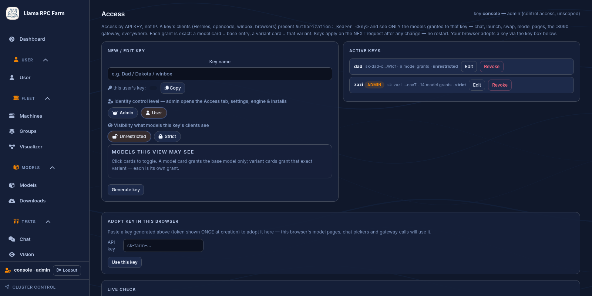

# Users, API keys, and clients

Every client identifies with a farm API key — there is nothing else to set
up. Create one key per person or device in the UI (Settings → Access keys).
Each key gets a **model allowlist**, so your kid's PC shows only the fast
4B, your coding box shows the coder models, and an admin key sees
everything. Keys are also how usage is attributed per user in the dashboard.



## Connect a client

Point any OpenAI-compatible client at the gateway (`:8090`) or llama-swap
directly (`:8080`):

```
baseURL: http://<master-ip>:8090/v1     # or http://<master-ip>:8080/v1
apiKey:  <an access key from the Access settings>
```

Clients send the key as a normal auth header — same style as OpenAI:

```bash
curl http://<master-ip>:8090/v1/chat/completions \
  -H "Authorization: Bearer sk-farm-XXXX" \
  -H "Content-Type: application/json" \
  -d '{
    "model": "my-model-128k",
    "messages": [{"role": "user", "content": "hi"}],
    "stream": true
  }'
```

`X-Api-Key: sk-...` works identically; `Authorization: Bearer` is what
every OpenAI-compatible tool already sends, so most of the time you only
ever paste the key once. The master (or any trusted IP) can skip the key
entirely. List what a key can see:

```bash
curl http://<master-ip>:8090/v1/models -H "Authorization: Bearer sk-farm-XXXX"
```

Example opencode config:

```json
"provider": {
  "llamaswap": {
    "npm": "@ai-sdk/openai-compatible",
    "options": { "baseURL": "http://127.0.0.1:8090/v1", "apiKey": "<key>",
                 "timeout": 1800000, "headerTimeout": 300000,
                 "chunkTimeout": 600000 }
  }
}
```

Use generous read/chunk timeouts — local models on large contexts can sit
minutes between streamed chunks (prefill, RPC backends, memory pressure).

## What a key controls

| Field | Effect |
|---|---|
| `name` | Label only; used for usage attribution |
| `models` | **Exact grants**: `mid` (base model) or `mid--variant`. A bare mid grants only the base entry, not its variants |
| `admin` | Opens control surfaces (Access tab and admin APIs) |
| `admin_unrestricted` / `unrestricted` | When off, an admin keeps control surfaces but their **model visibility stays scoped** to the key's grants |
| `ui` | Per-key theme state |

Rules:

- No keys configured at all ⇒ everything is open (pre-Access farm state).
- Loopback / the operator console stays trusted for the farm's own calls.
- Unknown or missing key once keys exist ⇒ restricted: generate paths answer
  `401`, model lists are empty, and scoped models 404 like they do not exist.
- A key with no `models:` list sees everything (unless it is an
  `admin_unrestricted: false` strict admin? — strict only affects admins).
- `private: true` on a model hides it from every key-scoped request
  regardless of grant membership; scoping can only narrow.

The gateway enforces this **before** forwarding to llama-swap: it rewrites
`/v1/models` per caller and rejects generate requests for models the key is
not granted. It also records usage (exact llama.cpp `timings` when present,
estimated for streams) without ever seeing the raw token in the collector.

## Where keys live

Access keys, views, and per-key UI state live in the per-install,
git-ignored `config/settings.yaml` (never in git). Agent tokens and the HF
token live only in the encrypted vault (see [secrets.md](secrets.md)).
Passwords for web logins are one-way SHA-256+salt fingerprints; the vault
never sends secrets to the browser, only `agent_token_set` / `hf_token_set`
flags.

## First login

A fresh install has no default credentials. The UI opens **Create admin
account** (or `POST /api/auth/bootstrap`) and creates the first web login
plus its admin access key. Once any login or key exists, bootstrap is
admin/console-only. Later logins and keys are managed from the app.

API reference: [api.md](api.md). Setup walkthrough: [setup.md](setup.md).
