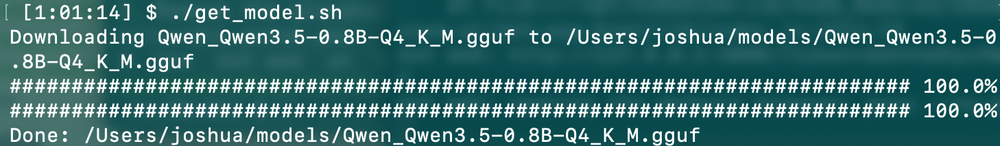

## Smoke test (MacOS Metal + Linux RAM CPU)

Run a small GGUF model on a Mac with a Linux RPC worker. 

### Prerequisites

| Component | Requirement |
|---|---|
| Mac (Master) | Apple Silicon; llama-server built with Metal and RPC support |
| Linux (worker) | Compatible ggml-rpc-server build; CPU device available |
| Connection | SSH key access; TCP port 50052 reachable; Trusted VPN (for WiFi connection using generic routers on default configs)|
| Worker binary | Verify its Linux path; default is `$HOME/llama-rpc-worker/build/bin/ggml-rpc-server` |

> Run the commands below from the repository's `scripts` directory. Replace `<YOUR_IP>` and `<YOUR_USER_NAME>` with your Linux worker's address and SSH username.

### Get the model

Model-download placeholder: obtain `Qwen_Qwen3.5-0.8B-Q4_K_M.gguf` and place it in `$HOME/models`.

```bash
./get_model.sh
```


### Terminal A — worker logs

```bash
./start_worker_linux.sh <YOUR_IP> <YOUR_USER_NAME>
```

The worker must already be running for the currently verified path; automatic startup has unresolved binary-path and log-redirection quoting issues.


### Terminal B — inference server

```bash
./run_cli.sh <YOUR_IP> <YOUR_USER_NAME>
```

Wait until the model finishes loading. The HTTP endpoint is `http://127.0.0.1:8084`.


### Terminal C — sample generation

```bash
./test_inference.sh "<SAMPLE_TEXT>" <MAX_OUTPUT_TOKENS>
```

Example:

```bash
./test_inference.sh "The capital of Austria is" 32
```


The live timer stays on one line. The result prints generated text, request elapsed time, and tokens/sec. Timer and elapsed numbers are blue; tokens/sec numbers are light blue.


