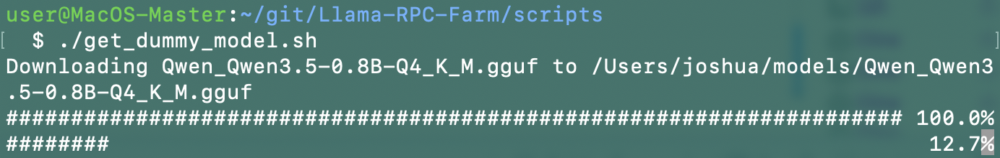
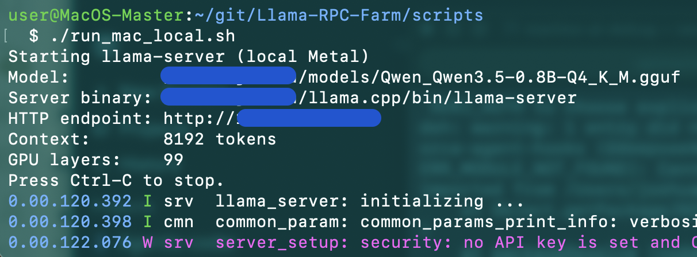
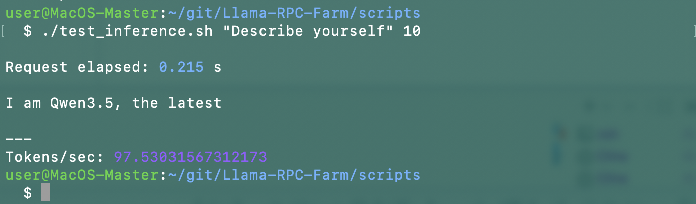
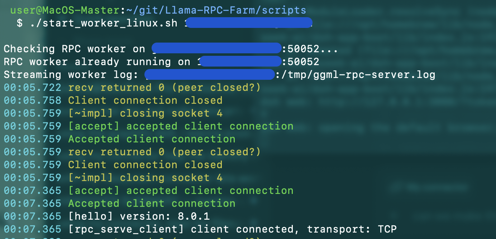
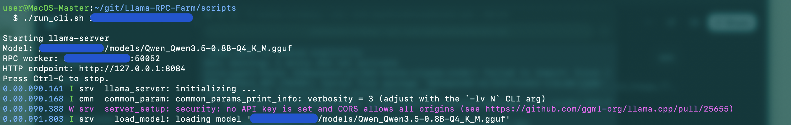
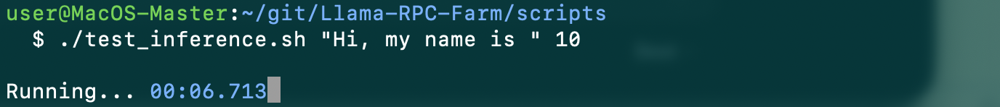
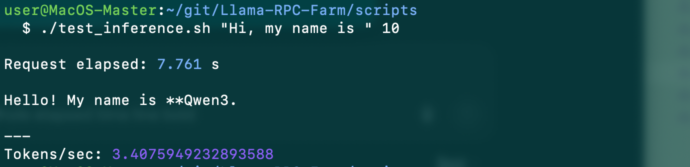

# Examples

Minimal examples with step by step procedures.

## Single-device Smoke test (MacOS Metal)

Run a small GGUF model locally on the MacOS

### Prerequisites

| Component | Requirement |
|---|---|
| Mac | Apple Silicon; llama-server built with Metal and RPC support |


### Get the model

Download `Qwen_Qwen3.5-0.8B-Q4_K_M.gguf` into `$HOME/models` (override with `MODEL_DIR`):

```bash
./get_dummy_model.sh
```


### Terminal A — inference server

```bash
./run_mac_local.sh 
```

Wait until the model finishes loading. The HTTP endpoint is `http://127.0.0.1:8084`.



Larger models might take longer to load.

### Sample generation

With Terminal A running the service, run:

```bash
./test_inference.sh "<SAMPLE_TEXT>" <MAX_OUTPUT_TOKENS>
```


Example:

```bash
./test_inference.sh "The capital of Austria is" 32
```




## Server Smoke test (MacOS Metal + Linux RAM CPU)

Run a small GGUF model on a Mac with a Linux RPC worker.

This path is **agent-only**: the Linux box must already be added on the
**Machines** page, with the peer agent running on its `agent_port`
(default `8198`) and a valid agent token. No SSH, `nc`, or remote shell is
involved — the scripts call the same peer-agent endpoints the app uses.

### Prerequisites

| Component | Requirement |
|---|---|
| Mac (Master) | Apple Silicon; `llama-server` built with Metal and RPC support |
| Linux (worker) | Added in the farm UI; peer agent reachable; `ggml-rpc-server` available to the agent (default from its install, or `PEER_AGENT_RPC_BIN`) |
| Network | Mac can reach the worker's agent port (default `8198`) and RPC port (default `50052`) on the LAN/VPN |
| Agent token | Already configured for the machine (the app's vault) |

> Run the commands below from the repository's `scripts` directory. Pass
> the worker's configured **IP, machine name, or ID** — no username is
> needed.

### Get the model

Download `Qwen_Qwen3.5-0.8B-Q4_K_M.gguf` into `$HOME/models` (override with `MODEL_DIR`):

```bash
./get_dummy_model.sh
```


### Terminal A — start the worker

```bash
./start_worker_linux.sh <WORKER_IP>
```

The script checks the agent, starts a CPU-only `ggml-rpc-server` via
`POST /rpc/ensure` (`devices: ["CPU"]`), then waits for the RPC port to
open (`GET /port/open`). Use it as `./start_worker_linux.sh <ip|name|id>
[rpc-port] [agent-port]`.



### Terminal B — inference server

```bash
./run_shared_dummy.sh <WORKER_IP>
```

This runs `llama-server` locally on the Mac with `--rpc <worker>:50052`
and `--device MTL0,RPC0`. Wait until the model finishes loading; the HTTP
endpoint is `http://127.0.0.1:8084`.



### Terminal C — sample generation

```bash
./test_inference.sh "<SAMPLE_TEXT>" <MAX_OUTPUT_TOKENS>
```

Example:

```bash
./test_inference.sh "The capital of Austria is" 32
```





