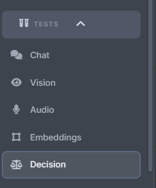

# Testing

## In-app test bench

The built-in test bench (Tests tab) covers every llama.cpp capability right
where the models live, so you verify a model through your real cluster
before a client sees it:

| Test | What it exercises |
|---|---|
| **Chat** | streaming conversations against llama-swap, any text model |
| **Vision** | multimodal image input (models with an `mmproj` projector) |
| **Audio** | ASR / audio-capable models |
| **Embeddings** | `/v1/embeddings` models |
| **Decision** | structured-choice (`/v1/systemone`) models |

Each type routes through the same views, access keys, and `:8090` gateway
as production traffic, so the test is the whole chain, not just the model.



## Test suite (development)

```bash
.venv/bin/python -m pytest tests          # all tests, fully stubbed, ~3s
.venv/bin/python -m pytest tests/test_swap_manager.py::test_stop_targets_correct_machine
./tests/e2e/single_node.py --help         # installed-package end-to-end test
```

The default suite fakes peer-agent calls and never contacts real hosts, so
it is safe to run anywhere. Several tests assert **exact rendered
script/CLI strings** — a behavior change usually means updating the
expected string too (for example `tests/test_render_rpc.py` and
`tests/test_port_roll.py`).

Syntax gates used by CI:

```bash
python -m compileall -q src
node --check ui/static/app.js
bash -n install.sh run.sh restart.sh
```

Release runners additionally run `tests/e2e/single_node.py`, which installs
the packaged app/agent, downloads a tiny CPU model, starts llama-swap
through the app, and asserts a chat completion through the real `:8090`
gateway.

More: [development.md](development.md) and [AGENTS.md](../AGENTS.md).
